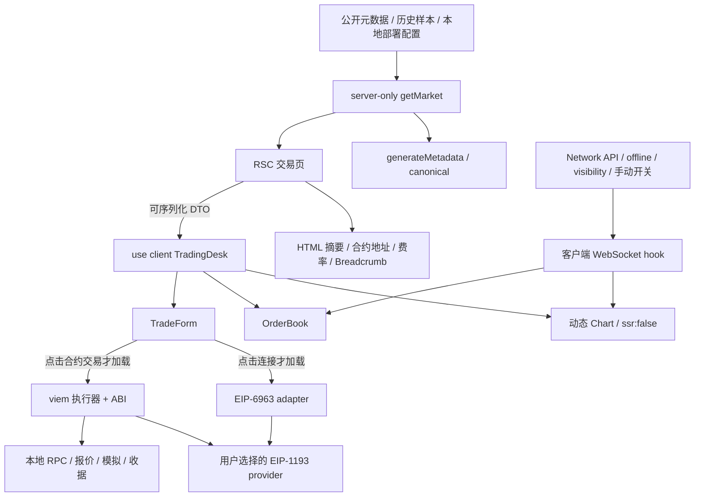

# 面试讲解：RSC 与合约交易边界

## 开场定位

“我把公开、可缓存、需要被抓取的信息交给服务端，把依赖浏览器状态、钱包权限和实时连接的行为放在客户端小岛。交易页面本身仍是 RSC；客户端只接收有界、可序列化的公开快照。性能、SEO 和签名安全是分别验证的。”

## 组件与数据流



首页、交易对介绍、FAQ、layout 和交易 route 均不含 `'use client'`。交互状态没有放在全站 Provider 中；钱包模块不会因为访问 FAQ 而初始化。

## RSC 与 SSR 不是二选一

RSC 决定模块在哪运行，以及哪些代码不进入客户端组件包；SSR/静态预渲染决定首屏 HTML 如何生成。`'use client'` 划定客户端模块图，不意味着“这个组件只在浏览器 render”。在 Next 14 首次访问时，客户端组件也可以生成非交互的服务端 HTML。

本项目对公开页采用构建预渲染 + 60 秒 ISR。`React.cache` 做请求内去重；路由 ISR 和配置的 `fetch(..., { next: { revalidate: 60 } })` 才承担跨请求缓存语义。不要把 `React.cache` 讲成永久缓存。

订单表和表单壳保留首屏 HTML。Lightweight Charts 依赖 Canvas、DOM 和 ResizeObserver，只有该叶子通过 `dynamic(..., { ssr: false })` 关闭 SSR。服务端历史摘要始终存在，图表不是唯一的数据载体。

Trade-off：静态/ISR 内容可能滞后，所以显示快照时间、数据来源；它不能作为实际交易报价。动态 SSR 可以更新每次请求的内容，但增加响应依赖与服务器成本，且仍无法知道用户浏览器钱包的授权状态。

## 三个懒加载切点

| 内容 | 触发时机 | 收益与代价 |
| --- | --- | --- |
| Lightweight Charts | 网络策略允许且图表挂载 | 弱网初始不加载 Canvas 图表；正常模式出现短暂骨架，避免整页客户端化 |
| EIP-6963 adapter | 点击“连接钱包” | 公共页与无钱包模拟流程不执行发现逻辑；首次连接多一次模块请求 |
| viem 执行器、合约 ABI | 点击合约买卖 | 初始工作区不带完整签名依赖；签名前需要展示加载/校验状态 |

ABI 没有作为 RSC props 发到浏览器，也没有被表单顶层静态导入。浏览器测试检查实际下载的 JS：连接前没有钱包发现事件字符串，连接后才出现；交易前没有 swap ABI，交易后才出现。构建输出的 First Load JS 只表示初始依赖，不等于整个会话下载量。

## 弱网与实时数据生命周期

1. 首次 SSR 和首次客户端 render 使用相同“检测中”状态，避免 hydration mismatch。
2. effect 中读取 `navigator.connection`。`saveData`、slow-2g/2g/3g、有效下行小于 1 Mbps、RTT ≥ 600 ms 会暂停。阈值是产品策略，不是精确测量。
3. 离线、后台标签和手动静态模式也会暂停。effect 清理会**真正关闭 WebSocket**，不是隐藏 Canvas 后继续收行情。
4. 不支持 Network Information API 时标明自动检测不可用，保留手动静态开关；连接失败仍可以降级。未知不被解释成已测得高速网络。
5. 单帧限制大小、校验 OHLC 和订单簿、有序 sequence 与时间戳过滤。历史最多保留 240 根。10 秒没有有效帧会断开；退避最多三次，之后保留静态视图和“重新连接”。
6. 静态模式的骨架不持续假装加载，明确显示“已暂停”；行情恢复时重建连接。组件销毁时移除监听器、timer、socket 和图表实例。

Trade-off：这是有界的演示流，不具备金融行情的缺口恢复协议。生产需明确增量/快照序列、重连补齐、交易所日历、订单簿一致性和 UI 背压。公共静态摘要与不可执行的最新参考价必须有清晰区分。

## 钱包与交易流程

发现流程先监听 `eip6963:announceProvider`，再派发 `eip6963:requestProvider`，避免错过同步响应。按 UUID 去重并限制数量，不依赖多个扩展对 `window.ethereum` 的覆盖顺序。钱包名、rdns、图标都不可信；不把 SVG 注入 HTML，不把 rdns 当作已验证身份。连接只由用户点击触发。

账户、网络与 disconnect 事件都有销毁逻辑。每次异步等待后，在下一次签名前重新核对 `eth_accounts` 和 `eth_chainId`。RPC 仅允许本机，合约部署和执行仅允许 31337；代码和 token 地址也在执行前验证。

```text
金额/滑点整数校验
  → 校验钱包账户、钱包链、本地 RPC 链、合约及代币精度
  → 读取余额和 allowance
  → 必要时精确授权 → 授权签名 → 授权成功收据
  → 重新读取链上 quote → 计算 minOut 和 deadline
  → simulateContract → 再次核对账户/链 → 交易签名
  → hash（已提交）→ receipt.status（执行结果）
  → 记录已确认成交 → 独立刷新余额
```

| 场景 | UI/执行行为 | 风险与取舍 |
| --- | --- | --- |
| 错误网络／账户改变 | 禁止下一步签名，要求重新检查 | chainId 不能证明两个 RPC 是同一个本地节点；Demo 假定钱包连接上述本机节点 |
| allowance 不足 | 精确授权本次数量，确认后再 swap | 多一次签名；不提供无限授权。任意第三方 token 的 zero-reset 等差异未在此 Demo 支持 |
| 拒签／模拟回滚 | 显示未完成，不添加成交 | 模拟成功不能保证实际上链成功 |
| 已有 hash，收据等待失败 | 结果待确认，显示 hash，锁定该会话合约下单 | 不能把 RPC 超时解释成失败后立即重发；生产需持久化并恢复待确认交易 |
| 交易替换 | 重定价沿用新的 hash；取消／不同交易替换不记成交 | 替换检测依赖 RPC/SDK；完整恢复 UI 未实现 |
| 成功收据后余额读取失败 | 保留成交成功，单独提示余额刷新不可用 | 写入结果与读取模型分离，避免用户因错误提示重复交易 |
| 行情与执行报价不同 | 图表标记合成行情，合约报价单独读取 | 固定价合约不是 AMM 或订单簿撮合；不能把装饰性深度当成交承诺 |

签名与广播只在客户端执行。RSC 不读私钥、不调用钱包、不调用 TronWeb、不创建 WebSocket。交易金额使用 bigint；只有图表和展示行情使用 number。

## SEO 门禁为什么检查原始 HTML

仅在 Playwright 水合后检查标题和正文，会漏掉“内容全在客户端”的回归。`scripts/check-seo.ts` 以 Googlebot User-Agent 获取原始响应，检查四条页面的非空、唯一 title，唯一绝对 canonical，路径/域名一致，H1、可索引设置、Breadcrumb JSON-LD 和可抓取摘要。首页 URL 仅规范化末尾 `/`，不会放过错域名或错路径。

`app/sitemap.ts` 和 `app/robots.ts` 使用同一个 origin；Breadcrumb 数据将 `<` 转义成 `\u003c`，避免未来外部交易对名造成 script 注入。未知交易对调用 `notFound()`，不伪造有效内容。

Trade-off：门禁能验证技术条件，不能证明 Google 已索引，也不是完整 SEO 审计。实际公开部署还需要正确域名、可访问 HTTP 状态、无身份验证障碍及真实内容。

## 面试现场推荐演示顺序

1. 禁用 JavaScript 打开交易对页和交易页：介绍、历史摘要、地址、费率和面包屑仍存在。
2. 看 Network JS 列表：打开图表、连接钱包、下单，观察三个加载边界。
3. 切换静态模式或模拟 NetworkInformation 的 change 事件：WebSocket 关闭、图表卸载、摘要仍可读；恢复后重新连接。
4. 演示错误网络、拒签和正常授权 + swap；说明“同意签名”“拿到 hash”“receipt 成功”的区别。
5. 展示 `npm run verify`，尤其是禁用 JS、弱网断流、懒加载和成交后余额读取失败的回归测试。

## 生产化尚需完成

真实行情和 DEX/router 集成、持久订单/待确认交易恢复、目标链确认与重组策略、报价过期与 MEV 约束、真实钱包兼容矩阵、RPC 故障切换、可观测性、限流与安全审查。当前无 Server Actions、无业务登录、无私钥服务；不能从本地测试通过推断生产资金安全或合约已审计。

按需求使用 Next 14，但该大版本已退出官方支持。生产选型需升级并重新验证 RSC、缓存与安全边界。

## 官方依据

- [Next 14 Server Components](https://nextjs.org/docs/14/app/building-your-application/rendering/server-components)
- [Next 14 Lazy Loading](https://nextjs.org/docs/14/app/building-your-application/optimizing/lazy-loading)
- [Next 14 Sitemap](https://nextjs.org/docs/14/app/api-reference/file-conventions/metadata/sitemap)
- [EIP-6963 标准](https://eips.ethereum.org/EIPS/eip-6963)
- [TradingView Lightweight Charts](https://tradingview.github.io/lightweight-charts/docs)
- [MDN Network Information API](https://developer.mozilla.org/en-US/docs/Web/API/Network_Information_API)
- [Next.js 支持策略](https://nextjs.org/support-policy)
